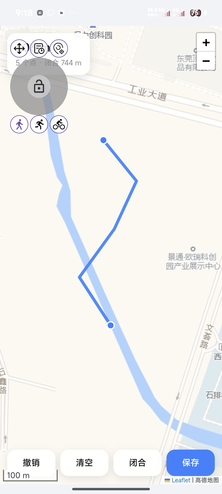
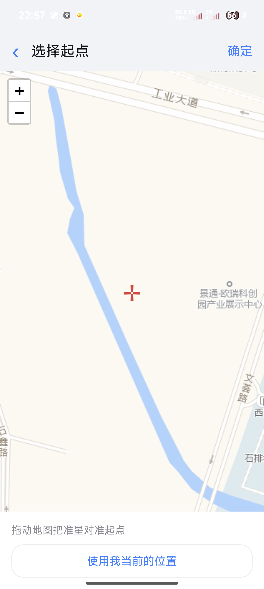
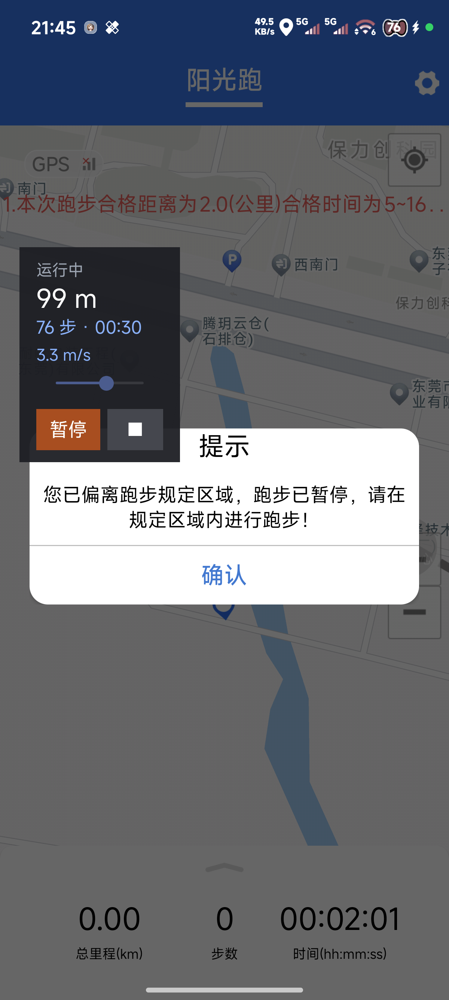

<div align="center">


# 随心跑 · MokrRun

**在地图上画一条线，让它替你跑完**

[](../../releases)
[](../../releases/latest)
[](LICENSE)
[](#-兼容性)
[](#-安装)
[](#-从源码构建)
[](../../stargazers)

一个 LSPosed 模块：把「校园跑」类应用的轨迹与步数，变成可规划、可调速、可复现的模拟。

<br/>

### ⬇️ 下载

[**MokrRun-1.0.115.apk**](../../releases/latest) · 329 KB · Android 8.0+

<sub>所有版本见 [Releases](../../releases) 页</sub>

</div>

---

## 📑 目录

- [✨ 特性](#-特性)
- [📸 界面](#-界面)
- [🚀 快速开始](#-快速开始)
- [🔧 工作原理](#-工作原理)
- [⚙️ 参数与实测数据](#️-参数与实测数据)
- [🧩 兼容性](#-兼容性)
- [❓ FAQ](#-faq)
- [🛠️ 从源码构建](#️-从源码构建)
- [📝 更新日志](#-更新日志)
- [⚠️ 免责声明](#️-免责声明)
- [📄 许可](#-许可)

---

## ✨ 特性

| | 能力 | 说明 |
|---|---|---|
| 🗺️ | **画线即跑步** | 全屏地图点击即加途经点，起点可单独用十字准星对准 |
| 🎯 | **位置与步数同源** | 同一个 250 ms tick 驱动插值与步频，物理上不会「步数涨了位置没动」 |
| 🎚️ | **速度可调** | 设置页调速，步频与步长按步态规律自动换算（默认 4.8 m/s） |
| 🛰️ | **定位质量伪装** | 卫星数、GPS 状态、精度状态、provider 一并伪装，不再被判「GPS 轨迹异常」 |
| 🧭 | **GNSS 卫星合成** | 直接向系统 GNSS 回调推送 12~16 颗星的合成状态 |
| 🙈 | **反检测** | `isMock` / `isFromMockProvider` 恒 false，虚拟定位类包名从包列表隐藏 |
| 🏃 | **人脸识别自动停表** | 中途弹出人脸识别立刻冻结位置，识别完自动继续，不会超出 150 米窗口 |
| 🪟 | **悬浮窗一键控制** | 可拖动的悬浮面板：开始 / 暂停 / 继续 / 结束 |
| 🕘 | **最近三条路线** | 画过的路线自动留档，超出淘汰最旧的 |
| 🔒 | **零权限门槛** | 不需要 adb、不需要手动改系统设置，装上勾选作用域即可用 |

---

## 📸 界面

<div align="center">

| 首页 | 画路线 | 起点校准 | 跑步中 |
|:---:|:---:|:---:|:---:|
|  |  |  |  |

| 悬浮窗 | 设置 |
|:---:|:---:|
|  | 速度 / 步频 / 步长 / 反检测开关 |

</div>

---

## 🚀 快速开始

### 环境要求

| 项 | 要求 |
|---|---|
| Android | 8.0（API 26）及以上 |
| Root | 需要（解锁 Bootloader） |
| 框架 | LSPosed（或兼容的 Xposed 实现），Xposed API ≥ 93 |
| 系统 | 原生 Android / LineageOS / MIUI / HyperOS |

### 安装

1. 从 [Releases](../../releases) 下载最新的 `MokrRun-x.x.x.apk` 并安装
2. 打开 **LSPosed** → 模块列表 → 启用「随心跑」
3. 进入作用域设置，**勾选目标应用**（默认 `com.bxkj.student`）
4. 强制停止目标应用一次，让它重新加载模块

> 首次打开「随心跑」需要手动允许**悬浮窗**与**定位**权限。

### 使用

```
① 修改起点 → 拖动地图对准起点 → 确定
② 绘制路线 → 点击加途经点 → 保存（悬浮窗出现，显示「就绪」）
③ 切到目标应用，进入跑步页面
④ 悬浮窗点「开始」→ 位置沿你画的线推进，步数同步累加
```

运行中可随时：拖动悬浮窗、暂停（位置冻结）、结束后交还真实定位。

---

## 🔧 工作原理

```
┌────────────────────┐                     ┌────────────────────────┐
│  MokrRun（控制端）   │  Intent / 广播      │  目标应用进程            │
│                    │ ──────────────────→ │                        │
│  画路线 / 调参数     │  cfg+origin+route   │  MotionEngine（250ms）  │
│  悬浮窗控制         │                     │   ├ 折线插值推进         │
│                    │ ←──── CMD 广播 ──── │   └ 步频累加 → 步数      │
└────────────────────┘                     │                        │
                                           │  LocationProbe          │
                                           │   └ 接管 LocationManager │
                                           │  SDKLocationHook        │
                                           │   ├ AMapLocation getter  │
                                           │   └ 定位质量报告          │
                                           │  GnssHook               │
                                           │   └ 合成卫星状态          │
                                           │  SensorHook             │
                                           │   └ 注入步数事件          │
                                           └────────────────────────┘
```

**几个关键设计**

- **位置与步数共享一个时间轴**：每 250 ms 推进一次，二者不可能漂移
- **两条零权限配置通道**：启动 Intent（`mokr_cfg/mokr_origin/mokr_route/mokr_run`）+ 显式广播（`com.mokrun.app.CMD`）。广播通道会一并携带配置，用于绕开「ContentProvider 冷启动被系统拦截」的情况
- **坐标系**：地图瓦片是 GCJ-02，控制端与引擎内部统一用 GCJ-02，下发前不再二次转换
- **三态状态机**：`0` 未开始（不接管定位）/ `1` 运行中 / `2` 暂停（位置冻结）

---

## ⚙️ 参数与实测数据

默认配方（`ConfigSync.buildLine()` 每次「开始 / 暂停 / 继续」随广播下发）：

```
speed=4.8  cadence=3.12  stride=1.54  spdmax=5.0  sat=14  qr=2  acc=0
```

**速度上限是实测出来的**（同一场次热切换，窗长 40~62 s，对比引擎与目标应用里程增量）：

| 设定速度 | 引擎实测 | 目标应用增量速率 | 比值 | 判定 |
|---|---|---|---|---|
| 2.8 m/s（10 km/h） | 2.76 | 2.80 | 1.01 | ✅ |
| 3.5 m/s（12.6 km/h） | 3.53 | 3.39 | 0.96 | ✅ |
| **5.0 m/s（18 km/h）** | 4.99 | 4.74 | 0.95 | ✅ |
| 5.5 m/s（19.8 km/h） | 5.64 | 2.64 | 0.47 | ❌ 只认一半 |
| 6.2 m/s（22 km/h） | 6.28 | 3.15 | 0.50 | ❌ 只认一半 |

> 结论：目标应用的速度上限在 **5.0~5.5 m/s** 之间，超过会**丢点但仍画轨迹**。
> 2 km 的合格窗口是 5~16 分钟 → 推荐 **4.5~5.0 m/s**（2 km 约 7 分钟）。

**为什么之前会被判「GPS 轨迹异常」**：质量报告里 `getGPSStatus = 0`、`getGPSSatellites = 0`（室内真实只有 3 颗星）。这三个值一并伪装成健康值后，指示灯变绿、提示消失、里程 1:1 对齐。

---

## 🧩 兼容性

| 环境 | 状态 | 说明 |
|---|---|---|
| 原生 Android / LineageOS | ✅ | 配置通道直接可用 |
| MIUI / HyperOS | ✅ | 已适配；注意 ContentProvider 冷启动会被拦，广播通道兜底 |
| 目标应用 `com.bxkj.student` | ✅ | 实测 v2.0.22（360 加固，业务代码在壳内） |

**已验证的设备**：小米 15（24129PN74C）/ HyperOS Android 16 (API 36) / SukiSU Ultra + LSPosed。

> 其他「校园跑」应用理论上可用，但定位 SDK 不同的话，需要补充对应的 hook。
> 目标应用若被加固，静态反编译拿不到业务逻辑，只能以运行时 hook 为主。

---

## ❓ FAQ

**Q：悬浮窗不出现？**
A：检查系统设置里是否允许「随心跑」显示在其他应用上层。

**Q：点了开始但位置不动？**
A：先确认画过路线——只有起点没有途经点时，位置会固定在起点。其次确认目标应用在模块更新后重启过。

**Q：目标应用显示里程只有一半？**
A：速度超过 5.5 m/s 了。降到 4.8~5.0 即可，引擎侧也有 `spdmax=5.0` 兜底。

**Q：目标应用一直亮「GPS ✕」/ 弹「轨迹异常」？**
A：质量字段没伪装到位。本模块会一并伪装 `getGPSStatus`、`getGPSSatellites`、`getSatellites`、`getGpsAccuracyStatus`，并向系统 GNSS 回调推送合成卫星；若仍异常，用 `adb logcat | grep "getter stats"` 看实际取值。

**Q：改了速度没反应？**
A：设置页写的是本地参数，需要在悬浮窗点一次「开始 / 暂停 / 继续」把它下发给目标进程；引擎侧还有 5.0 的硬上限。

**Q：换签名后装不上？**
A：Android 不允许签名不同的同包名覆盖安装，先卸载旧版本。

---

## 🛠️ 从源码构建

没有 Gradle，用一套手工流水线：`aapt2 → javac → r8/d8 → zip → zipalign → apksigner`。

```powershell
$env:MOKR_TOOLS  = "C:\mokrtools"     # 内含 jdk/、bt/android-14/、r8/r8.jar、android.jar
$env:MOKR_KS     = "C:\MokrRun\dsh.jks"
$env:MOKR_KS_PASS = "yourpass"

.\build.ps1                            # 主模块
.\tools\probe\build-probe.ps1          # 测试探针
.\install.ps1                          # 安装到已连接设备
```

工具链要点：

- **R8 9.5.29**：build-tools 自带的 `d8 8.2.2` 在遇到匿名内部类时会抛 `NullPointerException`，必须换 R8
- **需要 Python**：`build.ps1` 用 Python 的 `zipfile` 把 dex 与 assets 打进 APK
- **中文路径**：`aapt2` / `d8` 不支持，用 `mklink /J` 映射到纯 ASCII 路径
- **版本号**：由 `version.txt` 自增，构建时回写 manifest 与 `BuildConfigTag`

---

## 📝 更新日志

### v1.0.115

- 修复「定位质量」判定：伪装 `AMapLocationQualityReport.getGPSStatus / getGPSSatellites` 及 `getSatellites / getProvider / isMock / isFixLastLocation / altitude / gpsAccuracyStatus`
- 新增 `GnssHook`：向系统 GNSS 回调推送合成卫星状态（自适应 API 36 的 12 参 `Builder.addSatellite`）
- `Location` 补 `satellites / maxCn0 / meanCn0` extras，对齐真实 GPS 的数据形态
- 速度上限实测并落地为 5.0 m/s；默认速度改为 4.8 m/s（2 km ≈ 7 分钟）
- 步数跨场次单调递增，避免 `TYPE_STEP_COUNTER` 回退
- 中途人脸识别自动停表 / 恢复（150 米窗口内）
- 配置改走广播通道携带 `cfg/origin/route`，绕开 ContentProvider 冷启动被拦
- 弹窗探针覆盖 `Dialog.show / PopupWindow / AppCompat / Material`

<details>
<summary>更早的版本</summary>

- **v1.0.101**：暂停不再跳变、悬浮窗精简、步数按 listener 去重
- **v1.0.97**：暂停/继续/结束改用 `Activity.onCreate` 注册广播接收器
- **v1.0.x**：打通悬浮窗到目标应用的完整控制链路
- **v1.0.0**：首个可用版本（画线、插值推进、步数注入、悬浮窗）

</details>

---

## ⚠️ 免责声明

本项目仅用于学习 Android 定位 / 传感器 API 的 hook 技术，以及加固应用的运行时分析方法。
请勿用于伪造体测、竞赛或其他需要真实运动数据的场景；由此产生的一切后果由使用者自行承担。

---

## 📄 许可

[MIT](LICENSE)

<div align="center">

**如果这个项目对你有帮助，点个 ⭐ 就是最好的支持**

[](https://star-history.com/#QaQ-ciallo/MokrRun&Date)

</div>
